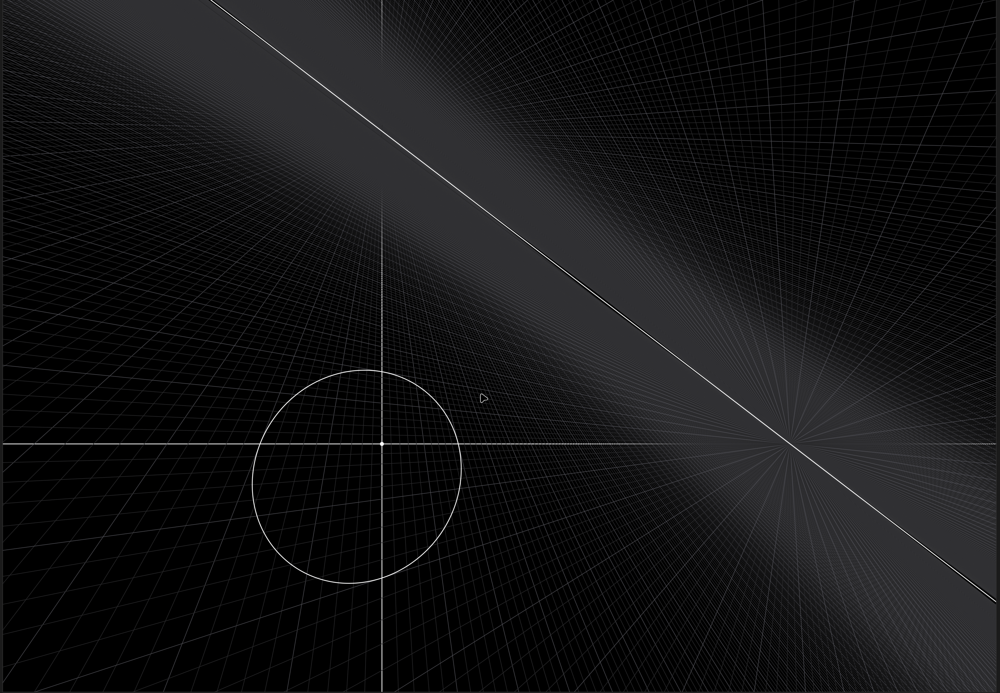

# GeoMKY 3
扩展欧氏几何可视化和探索软件，基于复齐次坐标，以自由射影视角显示，专为圆锥曲线设计

---

## 命令式数值计算几何

1. 给`射影平面`添加`无穷远直线`以及两个`虚圆点`
2. 使用`矩阵`和`齐次坐标`表示`圆锥曲线、点、直线`，基于复数计算
3. `复生量`抽象

这是最完美的几何环境，没有任何边界情况和分支
确定复杂度，结构和坐标无关，还有按照射影几何的成对关系自然抽象

## 为什么选择 GMK3

1. 文本指令驱动，易于传播交流和与 ai 协作
2. 射影自由视角，无穷远对象触目可及
3. 扩展欧氏几何平面可以消除传统几何的不连续，附庸条件
4. 专为圆锥曲线，射影几何，经典几何设计，相比 ggb 支持更多多多多多多操作，对偶量拥有独立抽象
5. 高性能和小体积，小的运行时开销

## 几何推理

不在 GMK 3 预期目标内
这是下一阶段 GMK 4 的目标，目前我正在使用 Lean 探索和形式化

## 用户界面

使用 egui wgpu 层高性能绘制射影视角和扩展欧几里得平面
将采用与 GeoGebra 类似的快速几何构建操作方式，按照类似 office 的方式经过深思熟虑操作方式重构

## ai 合作

本项目不是纯古法编程：
代码库含有 ai 生成代码，但这不影响代码质量
事实上，我（Duo）将会持续努力保证工程严谨，架构清晰可持续，性能和运行时开销，完全掌握程序行为

## 开始

| 运行                 | 命令                    |
|----------------------|-------------------------|
| web 调试             | `trunk serve --open`    |
| web 打包             | `trunk build --release` |
| 本地平台发布模式运行 | `cargo run --release`   |
